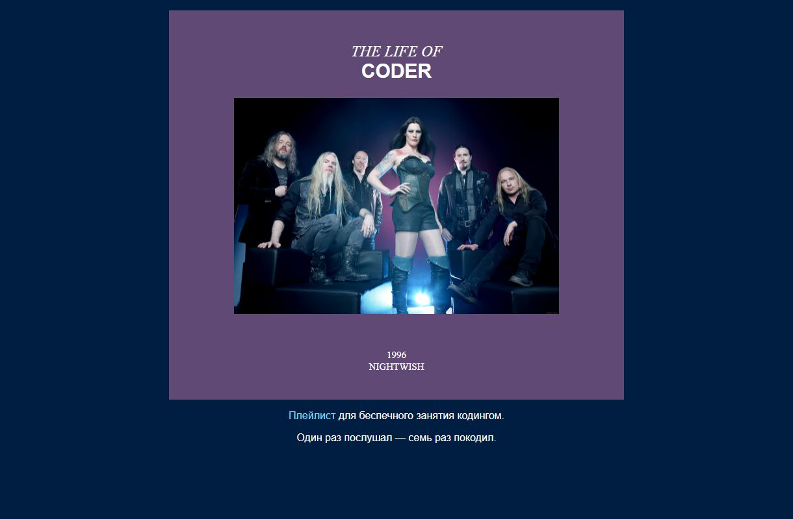

# 🎧 The Life of Coder

**Музыкальная открытка, стилизованная под обложку с надписями «1996» и «Nightwish».**

 

[Открыть обложку](https://goldlexx.github.io/playlist/)

Композицию задают крупная типографика и контраст между заголовком и подписью. Ссылка «Плейлист» ведёт на страницу исполнителя в Яндекс Музыке. Прослушивание происходит в музыкальном сервисе.

## Локальный запуск

Откройте `index.html` из корня репозитория в браузере.
